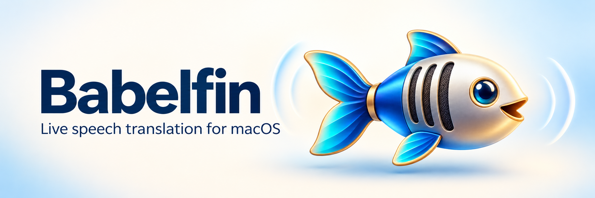
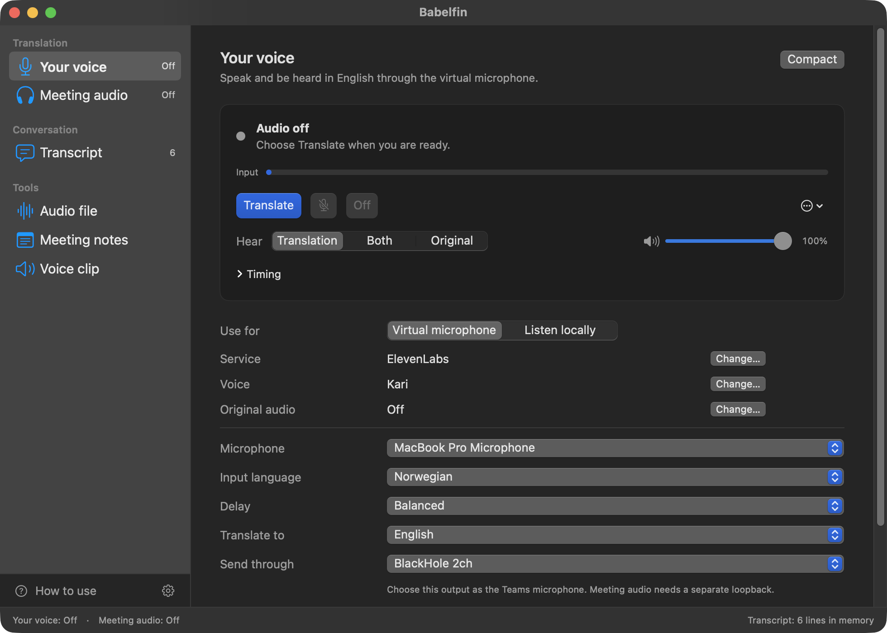
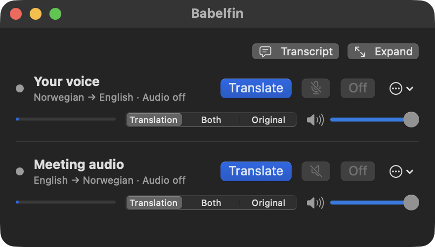

<p align="center"></p>

# Babelfin

Live speech translation for macOS. Speak into a Teams call and listen to the meeting in your language, or translate audio locally through your headphones.

[**Download for Mac**](https://github.com/tm-henningnt/babelfin/releases/latest) · [Website](https://tm-henningnt.github.io/babelfin/)

Apple Silicon (arm64), macOS 13 or later. Made by **Henning Naarlien-Tolpinrud**.

<p align="center"></p>

## How it works

Your voice and Meeting audio have independent language, service and voice settings. Start either direction or run both together. OpenAI direct translation detects the input language automatically. The other routes use ElevenLabs speech recognition, OpenAI text translation and an ElevenLabs or Fish Audio voice; you can use automatic input detection or select an input language. Available translation languages depend on the service.

For the ElevenLabs and Fish Audio routes, **Delay** sets how much speech Babelfin collects before it translates. **Fast** stays close behind the speaker, **More context** waits for longer passages, which can translate better, and **Balanced** is in between. Babelfin adjusts the speed of the translated voice slightly to keep the delay steady.

For ElevenLabs or Fish Audio output, select an account voice and preview it through a physical output. Meeting audio is never used as a voice sample.

Ready for calls can pass your original voice through when another app uses BlackHole. Choose when to turn translation on; Mute and Off take priority. Original and translated speech are not synchronized.

When a direction's input is BlackHole, Babelfin plays the original audio as soon as the app opens, so you hear the meeting or Mac audio before you translate. This starts only after you have allowed microphone access. **Off** stops it until you choose **Translate** again. A physical microphone never starts by itself. When you choose **Translate**, the original keeps its full volume until the first translated speech plays. While a direction plays only original audio, you can change its settings.

**Hear** chooses what you hear, also while translating: **Translation**, **Both** (the original under the translation, at the level and with the ducking set in Settings) or **Original**. With Original, translation keeps running, so the transcript continues, and the original fades up to full volume. **Stop translating** returns to the original audio and ends the translation connection. **Mute** silences the direction at once. **Off** stops all audio in the direction and turns off automatic activation.

Each direction has its own output volume: the slider in the main window and in Compact controls, or **Volume** in the menu bar menu. It changes only Babelfin's output for that direction, not the system volume, so it also works when macOS output goes to BlackHole and the Mac's own volume keys no longer control the speakers.

Open **Timing** under a direction's controls, or choose **Show timing** in Compact controls, to see how long each stage takes for ElevenLabs and Fish Audio: translation, the voice's first audio, waiting for the previous passage, and the total from the speaker's pause to translated speech. It shows the last passage and the median of the last 20. OpenAI does all stages in one step, so Babelfin cannot time them separately.

Choose **Compact** to keep both directions in a small window with the same controls. Expand the window to change the setup.

## Setup

Download the DMG, drag Babelfin to Applications, and open it. This download is **not notarized by Apple**. If macOS blocks it, follow [Apple’s instructions](https://support.apple.com/102445) using **System Settings → Privacy & Security → Open Anyway**. Your organization may restrict this option.

1. Choose a translation service in Settings and enter your own API keys for the services it uses. An OpenAI key is required; ElevenLabs and Fish Audio are optional. Choose local storage (recommended) or macOS Keychain for your keys in Settings → Accounts. Each service bills your account separately; a ChatGPT subscription does not include OpenAI API usage.
2. Install [BlackHole](https://github.com/ExistentialAudio/BlackHole#installation-instructions) separately for virtual microphone or system-audio routes. Follow its installer’s restart instructions. Babelfin does not install drivers or change system audio defaults.
3. For your voice in Teams, select **Your voice**, **Virtual microphone**, your physical microphone and BlackHole 2ch as output. In Teams, select BlackHole 2ch as the microphone.
4. To translate meeting audio at the same time, use a genuinely separate loopback device, such as BlackHole 16ch, for the incoming route. Select it as the Teams speaker and as **Meeting audio** input in Babelfin; choose your headphones as Babelfin’s output. BlackHole 16ch uses channels 1 and 2. The same device or a mirror cannot isolate the two streams. If translating only your voice, keep Teams’ speaker on headphones.
5. Choose the language and service in each direction, choose **Translate**, and approve microphone access if requested. Each direction can be stopped independently.

Keychain encrypts saved keys. **This Mac (local file)** avoids Keychain access prompts after app updates, but stores keys unencrypted in files restricted to your macOS account. Changing storage does not move or delete saved keys; enter them separately in the location you choose.

For local listening, select **Listen locally**, an input and physical headphones as output. To translate system audio, route macOS output to BlackHole and select that device as input; all audio sent there is captured. Restore your normal output afterward. Do not select the same loopback for input and output.

## Uninstall

1. In Settings → Accounts, choose **Remove all saved keys**.
2. Quit Babelfin and move it to the Trash.
3. To remove BlackHole as well, follow the [BlackHole uninstall instructions](https://github.com/ExistentialAudio/BlackHole#uninstallation-instructions).

## Tools

The **Tools** section of the sidebar works with a recording, meeting text or a short voice clip:

- **Audio file:** transcribe a local recording with OpenAI or ElevenLabs, add speaker labels with ElevenLabs, and translate the resulting text with OpenAI. Copy or save the original and translation.
- **Meeting notes:** use text from your meeting or paste a transcript, then make concise notes with OpenAI. Review, copy or save the result.
- **Voice clip:** type a short passage, choose an ElevenLabs or Fish Audio voice, then play or save a WAV file.

Each action shows which service it uses. Files are uploaded only when you ask to transcribe them.

<p align="center"></p>

## Meeting text and privacy

**Transcript** in the sidebar brings together original and translated text from both directions. Copy it with an optional prompt for another chatbot, or explicitly save it as plain text or JSON. It covers periods when translation is active, with gaps while translation is off or muted. Original-only audio is not transcribed. Text can be incomplete and is not necessarily attributed to individual speakers.

Babelfin tells you when the transcript is full; save and clear it to continue. Text stays in memory until cleared or you quit, unless you choose to copy or save it. Babelfin does not record your live audio. Selected services process audio or text, and their terms, retention policies and charges apply.

To update, choose **Babelfin → Check for Updates…**. Babelfin contacts GitHub only when you choose this, verifies the download against the release checksum, and restores the previous version if the update fails.

## Build from source

Install a recent macOS Swift toolchain (this project has been checked with Swift 6.4). No third-party Swift packages are required.

```sh
zsh scripts/test.sh
zsh scripts/build-app.sh
open dist/Babelfin.app
```

The default build is **ad-hoc signed for local review and not notarized**. Rebuilds can trigger microphone or Keychain permission prompts.

To rebuild the icons, run `zsh scripts/build-icons.sh`. To build the static site, run `python3 scripts/build_site.py --output .build/site` with a fresh output folder.

## License

Copyright © 2026 Henning Naarlien-Tolpinrud. **Source-available** under the [Sustainable Use License 1.0](LICENSE), with conditions on redistribution and commercial use. This is not an OSI open-source license. Instrument Serif is bundled under the SIL Open Font License in `site/fonts/OFL.txt`.
